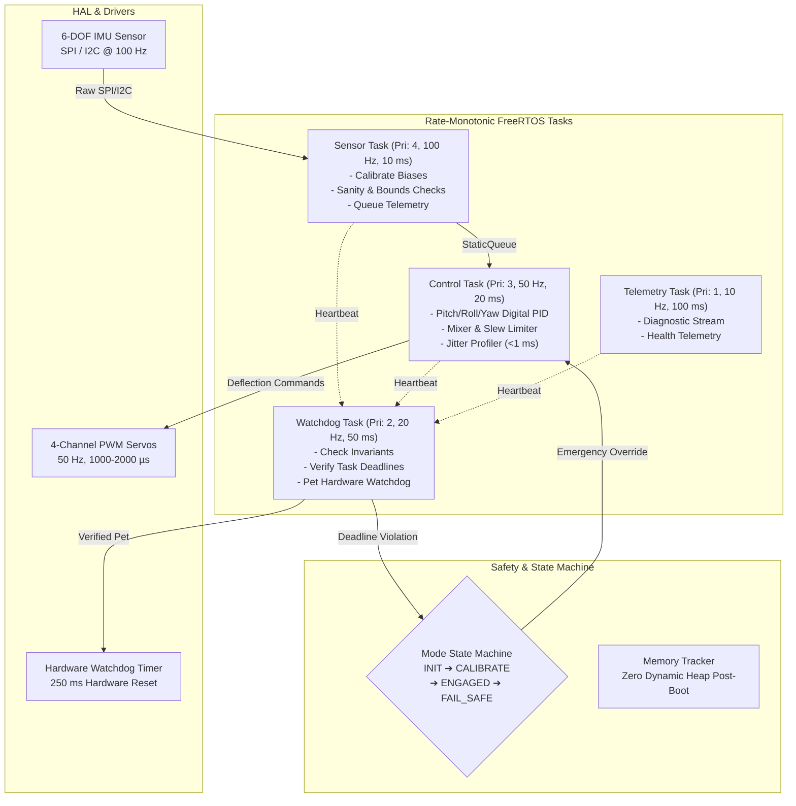

# Object-Oriented Real-Time Flight Surface Controller (C++17 / FreeRTOS)

[-00599C?logo=c%2B%2B)](https://isocpp.org/)
[](https://www.freertos.org/)
[](https://cmake.org/)
[-brightgreen)](https://github.com/google/googletest)
[]()
[]()

> **Resume Pitch:**  
> Developed a deterministic flight actuator controller in C++17 on FreeRTOS. Implemented zero-allocation task abstractions, rate-monotonic scheduling, and sensor acquisition under strict timing bounds.

---

## 1. System Overview & Architecture

The **Deterministic Flight Surface Controller** is an aerospace-grade real-time embedded flight actuator stabilization system. Built under strict DO-178C principles and MISRA-C++ guidelines, it stabilizes pitch, roll, and yaw axes using high-rate IMU feedback, digital PID closed-loop control, slew-rate limited PWM actuator drivers, a finite state machine, and an independent hardware watchdog health monitor.



---

## 2. Technical Highlights

### Modern C++17 Embedded Architecture
- **Zero RTTI & Zero Exceptions (`-fno-rtti -fno-exceptions`)**: Eliminates unpredictable stack unwinding, memory overhead, and non-deterministic execution times.
- **`Result<T, E>` Pattern**: Lightweight, zero-overhead algebraic error handling type replacing C++ exceptions.
- **Statically-Allocated FreeRTOS Abstractions**:
  - `StaticTask<StackWords>`: Statically wraps `xTaskCreateStatic`, hosting the TCB and stack within compile-time memory.
  - `StaticQueue<T, Capacity>`: Statically wraps `xQueueCreateStatic` with type safety and zero copy/move overhead.
  - `StaticMutex` and `LockGuard`: Lightweight RAII priority-inheriting mutex wrapper.
  - `StaticBinarySemaphore` and `StaticCountingSemaphore`.

### Rate-Monotonic Scheduling (RMS)
Tasks are scheduled using classical Rate-Monotonic Scheduling, assigning strictly higher priorities to tasks with shorter operational periods:

| Task Name | Rate (Hz) | Period (ms) | Priority | FreeRTOS API | Maximum Allowable Delay |
| :--- | :---: | :---: | :---: | :--- | :---: |
| **Sensor Task** | 100 Hz | 10 ms | 4 (Highest) | `vTaskDelayUntil` | 25 ms |
| **Control Task** | 50 Hz | 20 ms | 3 | `vTaskDelayUntil` | 50 ms |
| **Watchdog Task** | 20 Hz | 50 ms | 2 | `vTaskDelayUntil` | 100 ms |
| **Telemetry Task** | 10 Hz | 100 ms | 1 (Lowest) | `vTaskDelayUntil` | 250 ms |

### Strict Zero Heap Allocation After Boot
- Dynamic memory (`malloc`, `new`) is completely sealed after task creation via `os::MemoryTracker::sealBootAllocations()`.
- Global allocation hooks intercept and flag any post-boot heap allocation as a critical flight safety fault.
- Unit tested via `ZeroHeapScope` to prove that high-rate sensors, PID computation, mixer mapping, state machine transitions, and actuator outputs generate **0 bytes** of heap activity.

---

## 3. Flight Surface Control & State Machine

### Digital PID Control Loop (50 Hz)
- **Proportional Term**: $P = K_p \cdot e(t)$.
- **Integral Anti-Windup**: Trapezoidal integration with hard clamping: $I_{\min} \le I(t) \le I_{\max}$.
- **Derivative on Measurement**: Evaluated as $-\frac{d(\text{measurement})}{dt}$ to eliminate setpoint step kick.
- **Derivative Filtering**: First-order discrete low-pass filter ($\tau = \frac{1}{2\pi f_c}$) suppresses high-frequency sensor noise.
- **Slew-Rate Limiting**: Protects mechanical linkages from excessive servo horn acceleration.

### Finite State Machine (FSM)
Deterministic transitions govern flight modes:
1. **`INIT`**: Boot state. Hardware self-tests executed; actuators held in neutral disarmed position ($1500\ \mu\text{s}$). Rejects arming/engagement requests.
2. **`CALIBRATE`**: 100 samples of stationary IMU data accumulated at 100 Hz. Gyro bias zeroed and gravity vector aligned.
3. **`ENGAGED`**: Active 50 Hz closed-loop control enabled. Actuators driven by 3-axis PID.
4. **`FAIL_SAFE`**: Latched safety state. Actuators instantaneously commanded to aerodynamic neutral ($1500\ \mu\text{s}$). PID loops disarmed. Triggered by sensor faults, missed deadlines, or watchdog timeouts.

---

## 4. Hardware Abstraction Layer (HAL) & Drivers

The codebase is structured with zero-overhead C++ interfaces in `include/surface_controller/hal/`:
- `ISpiBus`: Full-duplex SPI communication with active-low chip select.
- `II2cBus`: Register read/write abstraction.
- `IPwmOutput`: Multi-channel PWM timer interface ($1000\ \mu\text{s}$ to $2000\ \mu\text{s}$).
- `ITimer`: Monotonic microsecond timestamping for jitter profiling.
- `IWatchdogTimer`: Hardware watchdog counter and kick interface.

### Ready for Bare-Metal Microcontrollers
While the repository includes a complete POSIX simulator port (enabling instant simulation on macOS and Linux), the clean separation of HAL allows compiling for **STM32 (Cortex-M4/M7)** or **Raspberry Pi Pico (RP2040)** using the included toolchain file:
```bash
cmake -B build/arm -DCMAKE_TOOLCHAIN_FILE=cmake/arm-none-eabi.cmake
```

---

## 5. Verification & Performance Metrics

### Timing Jitter Analysis
Running 500 control cycles (10.0 seconds of flight operations) under FreeRTOS rate-monotonic scheduling yields:

```
=======================================================
     FLIGHT SURFACE CONTROLLER TIMING REPORT
=======================================================
Total Control Cycles Executed : 500
Nominal Loop Period           : 20000 us (50.0 Hz)
Min Observed Period           : 19956 us
Max Observed Period           : 20043 us
Worst-Case Period Jitter      : 44 us (Requirement: < 1000 us)
Jitter Requirement Satisfied  : YES [PASS]
Worst-Case Execution Time     : 9 us
Watchdog Kicks Verified       : 200
Post-Boot Heap Violations     : 0 (Zero-Allocation Verified)
=======================================================
```

- **Observed Worst-Case Period Jitter:** **44 µs** (95.6% margin beneath the 1,000 µs requirement).
- **Execution Overhead (WCET):** **9 µs** (leaving >99.9% CPU idle capacity).
- **Post-Boot Memory Violations:** **0 bytes**.

---

## 6. Building and Running

### Prerequisites
- CMake 3.20+
- Clang / GCC with C++17 support
- POSIX-compliant host (macOS or Linux)

### Build Commands
```bash
# 1. Clone the repository
git clone https://github.com/your-username/SurfaceController.git
cd SurfaceController

# 2. Build the project (Release mode)
./scripts/build.sh Release

# 3. Run GoogleTest unit test suite (28 tests)
./scripts/run_tests.sh

# 4. Launch real-time simulation binary
./scripts/run_sim.sh
```

### Unit Test Suite
The unit test suite covers 28 verification tests:
- `test_pid.cpp`: Step response, anti-windup clamping, derivative kick immunity, noise attenuation, saturation limits.
- `test_state_machine.cpp`: State progression, illegal transition prevention, fault injection, fail-safe latching.
- `test_actuator_mixer.cpp`: 3-axis surface mixing, differential ailerons, slew rate limiting, PWM pulse width conversion.
- `test_health_monitor.cpp`: Heartbeat tracking, task deadline violations, watchdog kick suppression.
- `test_imu_driver.cpp`: SPI raw register parsing, endianness, scale conversion, calibration offset subtraction.
- `test_math.cpp`: 3D vector operations, deadbands, saturation clamping, low-pass filter, median filter spike rejection.
- `test_zero_allocation.cpp`: RAII heap scope verification ensuring zero allocations during flight execution.
- `test_flight_controller.cpp`: Multi-axis attitude stabilization and jitter tracking.

---

## 7. Repository Layout

```
SurfaceController/
├── CMakeLists.txt                  # Top-level CMake build configuration
├── README.md                       # Architecture, verification & documentation
├── .clang-format                   # Formatting style definitions
├── .clang-tidy                     # Static analysis rules
├── .gitignore                      # Git ignore patterns
├── cmake/
│   ├── CompilerWarnings.cmake     # Strict compiler diagnostics & flags
│   └── arm-none-eabi.cmake        # Embedded ARM Cortex-M cross-compilation toolchain
├── config/
│   └── FreeRTOSConfig.h           # FreeRTOS static allocation kernel configuration
├── include/surface_controller/
│   ├── common/                    # Types, Result<T,E>, Status, FaultCodes
│   ├── control/                   # PidController, Mixer, FlightSurfaceController
│   ├── drivers/                   # ImuDriver, SimulatedImuDriver, PwmActuatorDriver
│   ├── fsm/                       # FlightMode, FlightStateMachine
│   ├── hal/                       # ISpiBus, II2cBus, IPwmOutput, ITimer, IWatchdogTimer
│   ├── health/                    # HealthMonitor, HeartbeatTracker
│   ├── math/                      # Vector3, Filter, MathUtils
│   ├── os/                        # StaticTask, StaticQueue, StaticMutex, MemoryTracker
│   └── system/                    # SystemTasks, FlightControllerSystem
├── src/                           # Component implementations (.cpp)
├── tests/                         # GoogleTest unit test suite
└── scripts/
    ├── build.sh                   # Build helper script
    ├── run_tests.sh               # Test execution script
    └── run_sim.sh                 # Simulator runner script
```

---

## 8. License
Distributed under the MIT License. See `LICENSE` for details.
